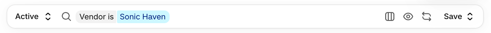

# Search & Filters Bar

[](https://www.npmjs.com/package/@ljsstudios/index-filter-bar)
[](https://github.com/ljsstudios/index-filter-bar/actions/workflows/ci.yml)
[](LICENSE)

The Shopify admin's index search and filter bar, for embedded Shopify apps built with React and **Polaris 2.0 web components** (`polaris-2.0.js`, the `s-*` elements). It is not for the older Polaris React library (`@shopify/polaris`).



**[Documentation](https://index-filter-bar.mintlify.site)** · **[Live demo](https://ljsstudios.github.io/index-filter-bar/)** · [npm](https://www.npmjs.com/package/@ljsstudios/index-filter-bar)

## What's included

- **Every filter type the admin has:** list, number, date, text, currency, measurement and read-only.
- **Saved views** with Reset, Save, Update and Save as new. The "Show view filters" eye hides a view's own filters until they're needed.
- **Columns and sort:** reorder, hide and sort columns from the admin's columns menu, or use a sort button on its own.
- **Choosing the parts:** saved views, sort, columns and filters are each optional, so a page can be as simple as the admin's Segments.
- **The URL:** search, filters, sort and view live in readable params, so a refresh or a shared link lands on the same list.
- **Long value lists** load 25 at a time, either from the page or from your server.
- **Accessible:** named controls, announced filter changes and full keyboard use, checked with axe against WCAG 2.2 AA.
- **Languages:** English, German, Spanish and French built in, and any other through a labels object.

It's matched to the admin's look and behaviour element by element, measured against the live admin.

The demo has four pages on sample data, each copying an admin page: Products, Inventory, Orders and Segments.

## Install

```sh
npm install @ljsstudios/index-filter-bar
```

Requirements:
- **React** 18 or 19.
- **Polaris 2.0 web components** on the page. A Shopify app home already loads them:

  ```html
  <script src="https://cdn.shopify.com/shopifycloud/polaris-2.0.js"></script>
  ```
- **`@shopify/polaris-types`** (optional), for typed `s-*` elements in your own JSX.

## Quick start

**1. Describe the filters, sorts and columns.**

```tsx
import type { FilterField } from "@ljsstudios/index-filter-bar";

const fields: FilterField[] = [
  {
    key: "vendor",
    name: "Vendor",
    multi: true,
    values: [
      { value: "acme", label: "Acme" },
      { value: "globex", label: "Globex" },
    ],
    operators: [
      { value: "is", label: "Is", chipLabel: "Vendor is" },
      { value: "is_not", label: "Is not", chipLabel: "Vendor is not" },
    ],
  },
];

const sortOptions = [{ field: "title", label: "Title", ascLabel: "A-Z", descLabel: "Z-A" }];

const columns = [
  { key: "vendor", label: "Vendor" },
  { key: "status", label: "Status" },
];
```

**2. Draw the bar, and send its state to your API.**

```tsx
import { IndexFilterBar, useIndexFilters } from "@ljsstudios/index-filter-bar";
import "@ljsstudios/index-filter-bar/style.css";

export const ProductsPage = () => {
  const bar = useIndexFilters({ fields, sortOptions, columns });

  // Your own data fetching: send the search, filters and sort.
  const { data, isFetching } = useProducts(bar.query, bar.filters, bar.sort);

  return (
    <s-page heading="Products">
      <IndexFilterBar {...bar.props} />
      <s-table loading={isFetching || bar.pending}>
        {/* one column per key in bar.visibleColumns */}
      </s-table>
    </s-page>
  );
};
```

**3. Keep saved views** (optional). Pass the stored views in, and store them when they change:

```tsx
const bar = useIndexFilters({
  fields,
  sortOptions,
  columns,
  views: shop.savedViews, // All first
  onViewsChange: (views) => api.saveViews(views), // return a promise
  onToast: (message) => shopify.toast.show(message),
});
```

Without a store, `localStorageViews(key, defaults)` keeps them in the browser, and `savedViews: false` leaves views out altogether.

The hook returns:

| | |
| --- | --- |
| `query` | The search text to send, 400ms after the last key (the admin's delay). |
| `pending` | True while typed text waits out that delay, so `loading={isFetching \|\| bar.pending}` shows loading from the first key. |
| `filters` | The filters to apply: `{ field, operator, values, shape? }[]`. |
| `sort` | `"field direction"`, for example `"title asc"`. |
| `visibleColumns` | Column keys to show, in the merchant's order. |
| `view` | The selected view: `{ index, title, dirty }`. |
| `hasFilters`, `clear()` | For an empty state's "Clear search and filters". |
| `props` | Spread into `<IndexFilterBar>`. |

The [quickstart](https://index-filter-bar.mintlify.site/quickstart) walks through a whole page.

## Filter types

Each type is a `FilterField`. The last column says where to see it in the Shopify admin.

| Type | What the merchant does | Admin example |
| --- | --- | --- |
| **List** (default) | Ticks one value (`multi: false`) or several (`multi: true`). | Products → Vendor, Status, Tag |
| **Number** | Types a number, or a range with Is between. | Inventory → Available, On hand |
| **Date** | Picks a preset, or types a date or range with a calendar. | Orders → Date, Fulfill by |
| **Text** | Types a value, optionally with a hint and a length. | Orders → Credit card (last 4 digits) |
| **Currency** | A number with the currency before it, starting as a range. | Orders → Order total |
| **Measurement** | A number with its unit after it, starting as a range. | Orders → Total product weight |
| **Read-only** | A grey chip the page sets, which can be removed but not opened or changed. | Purchase orders → Product variant |

See [filter types](https://index-filter-bar.mintlify.site/filter-types/overview) for each type's config, its conditions, and what its values look like.

## Choosing the parts

Each part shows only when the page gives it what it needs:

| The page gives | The bar draws |
| --- | --- |
| Everything | Views, search with filters, the columns menu, Reset and Save |
| `savedViews: false` | No views button, Reset, Save, eye or save modals |
| `sortOptions`, no `columns` | A sort button opening the sort list on its own |
| `columns`, no `sortOptions` | The columns menu without its Sort by row |
| No `fields` | A plain search box |

See [choosing the parts](https://index-filter-bar.mintlify.site/guides/customising).

## Languages

Every word comes from a labels object, English by default. Locale files for German, Spanish and French ship with the package:

```tsx
import de from "@ljsstudios/index-filter-bar/locales/de.json";

const bar = useIndexFilters({ fields, labels: de });
```

Change single words with `mergeLabels({ views: { all: "Everything" } })`. See [languages](https://index-filter-bar.mintlify.site/guides/languages).

## Lower-level parts

`IndexFilterBar` is built from the parts below, laid out as the admin lays them out. Use them directly for your own layout:
- `IndexBar`
- `ViewSwitcher`
- `SearchField`
- `ColumnsPopover`
- `SortPopover` and `SortMenu`
- `ViewFiltersButton`
- `SaveControls`
- `ViewModals`
- `SortableHeader`, for `s-table` headers

The pure helpers are exported too: `splitViewFilters`, `encodeFilters`, `decodeFilters`, `readSavedViews` and `reconcileColumns`. See the [API reference](https://index-filter-bar.mintlify.site/api/use-index-filters).

## Known limits

- **Icon hover colour:** Polaris icons come in fixed colours, so the bar's icons don't darken on hover as the admin's do.
- **Critical red:** "Delete view" uses Polaris's critical tone, a shade brighter than the admin's.
- **Currency picker:** the admin's code has a currency picker for fields that offer several currencies. No admin page uses it, so it's left out.

## Development

```sh
pnpm install
pnpm demo        # the demo on http://localhost:5180
pnpm check       # typecheck, lint, knip, tests
pnpm build       # dist/
```

The demo's products come from [mock.shop](https://mock.shop), Shopify's free sample Storefront API (`pnpm data:fetch`). Stock and orders are generated from them (`pnpm data:generate`). The docs live in `documentation/` (Mintlify). See [CONTRIBUTING.md](CONTRIBUTING.md).

## Licence

MIT © LJS Studios Ltd. Not affiliated with or endorsed by Shopify. Shopify and Polaris are trademarks of Shopify Inc.
